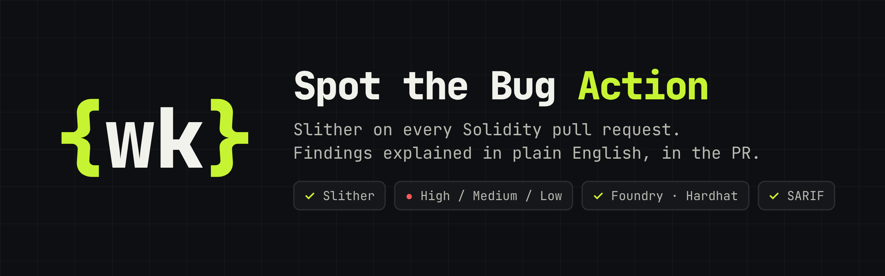
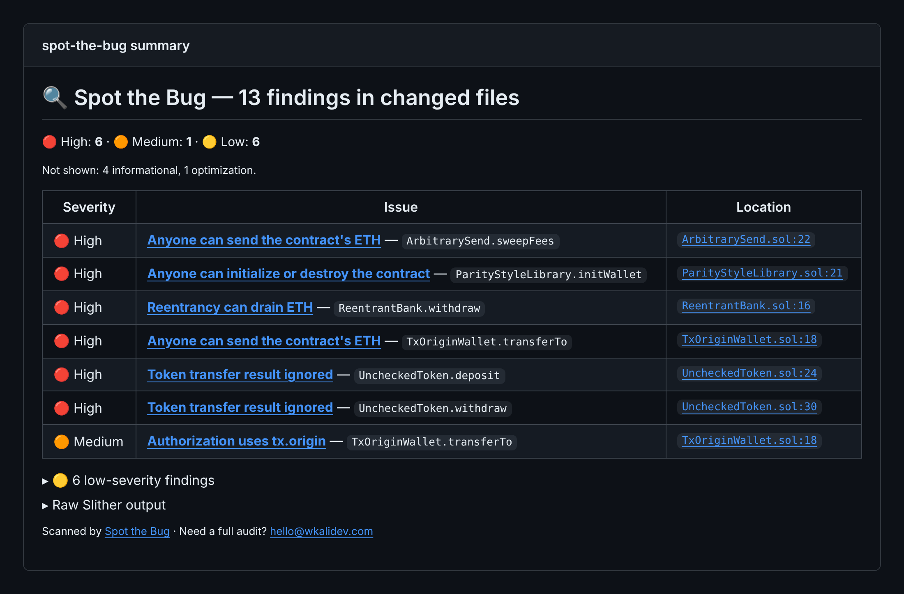

<p align="center"></p>

# Spot the Bug

Catch Solidity vulnerabilities in every pull request — before they reach mainnet.

[](https://github.com/marketplace/actions/spot-the-bug)
[](https://github.com/wkalidev/spot-the-bug-action/releases/latest)
[](LICENSE)

## Screenshots

### PR comment


One sticky comment per PR, with findings grouped by severity and explained in plain English.

👉 See it live on a real PR: https://github.com/wkalidev/spot-the-bug-demo/pull/1

### Job summary



The same report is written to the workflow run's job summary.

## Why Spot the Bug

- **Only changed files are scanned** — fast, and no noise from code you didn't touch.
- **One sticky comment** — updated in place on every push.
- **Plain-English explanations** — instead of raw [Slither](https://github.com/crytic/slither) output.
- **Nothing is lost** — low-severity findings are collapsed, and the raw Slither output is kept in a collapsed section.
- **Fail-on threshold** — block risky merges at the severity you choose.

## Quick start

```yaml
on: pull_request
permissions:
  contents: read
  pull-requests: write
jobs:
  spot-the-bug:
    runs-on: ubuntu-latest
    steps:
      - uses: actions/checkout@v7
      - uses: wkalidev/spot-the-bug-action@v1
        with:
          working-directory: .
          fail-on: high
```

Slither must be able to compile your project on the runner:

- **Foundry** — check out with `submodules: recursive` and add `foundry-rs/foundry-toolchain@v1` before the action.
- **Hardhat** — run `npm ci` before the action.

Foundry example:

```yaml
on: pull_request
permissions:
  contents: read
  pull-requests: write
jobs:
  spot-the-bug:
    runs-on: ubuntu-latest
    steps:
      - uses: actions/checkout@v7
        with:
          submodules: recursive
      - uses: foundry-rs/foundry-toolchain@v1
      - uses: wkalidev/spot-the-bug-action@v1
        with:
          fail-on: high
```

## How it works

- On `pull_request` / `pull_request_target`, only findings in added, modified or renamed `.sol` files are reported. If no Solidity file changed, the action exits successfully without commenting.
- On other events (`push`, `workflow_dispatch`, …), every finding is in scope and the summary is written to the job summary.
- The comment is updated in place on every run, so the PR keeps a single Spot the Bug comment.
- Informational and optimization findings are counted but not listed.

## Inputs

| Name                | Default               | Description                                                                                                     |
| ------------------- | --------------------- | --------------------------------------------------------------------------------------------------------------- |
| `github-token`      | `${{ github.token }}` | Token used to list PR files and post the comment.                                                               |
| `working-directory` | `.`                   | Root of the Solidity project (Foundry or Hardhat), relative to the repository root.                             |
| `solc-version`      | `0.8.24`              | Compiler version installed with `solc-select`.                                                                  |
| `fail-on`           | `high`                | Fail the job if a finding at or above this severity exists in changed files: `high`, `medium`, `low` or `none`. |
| `slither-args`      | `""`                  | Extra arguments passed to `slither`.                                                                            |

## Outputs

| Name             | Description                                               |
| ---------------- | --------------------------------------------------------- |
| `findings-count` | Number of High, Medium and Low findings in changed files. |
| `high-count`     | Number of High findings in changed files.                 |

## Upload results to GitHub code scanning

Slither can also write its results as SARIF in the same run. Pass `--sarif` through `slither-args`, then upload the file with `github/codeql-action/upload-sarif`:

```yaml
on: pull_request
permissions:
  contents: read
  pull-requests: write
  security-events: write
jobs:
  spot-the-bug:
    runs-on: ubuntu-latest
    steps:
      - uses: actions/checkout@v7
      - uses: wkalidev/spot-the-bug-action@v1
        with:
          fail-on: high
          slither-args: --sarif ${{ runner.temp }}/slither.sarif
      - uses: github/codeql-action/upload-sarif@v4
        if: always()
        with:
          sarif_file: ${{ runner.temp }}/slither.sarif
          category: slither
```

- Code scanning is free on public repositories; private repositories need GitHub Code Security (Advanced Security).
- `security-events: write` is required for the upload. Fork PRs get a read-only token, so the upload fails there.
- `if: always()` uploads the results even when the job fails because of `fail-on`.
- SARIF paths are relative to `working-directory`. Keep it at `.` so code scanning can map alerts to files.

How SARIF results relate to the PR comment:

- **PR comment and job summary** — only findings in changed `.sol` files, explained in plain English, refreshed on every push.
- **Code scanning** — every finding Slither reports for the whole project, including informational and optimization, tracked as alerts under the Security tab. On pull requests, code scanning only annotates alerts on the changed lines.

Both come from the same Slither run, so findings in changed files match.

## Roadmap

Custom rules inspired by real hacks from the Spot the Bug video series:

- ERC-4626 vault inflation attacks
- Infinite token approvals
- Uninitialized proxies

## License

[MIT](LICENSE)

---

Built by [wkalidev](https://github.com/wkalidev) · Need a full smart contract audit? hello@wkalidev.com
